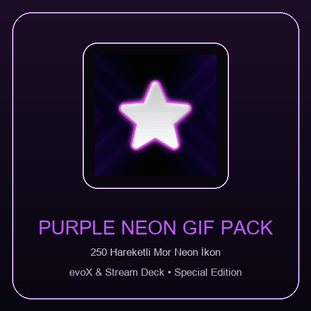

  
  <h1>Purple Neon Animated GIF Pack (250 Icons)</h1>
  
<strong>250 Deep Amethyst & Violet Cyberpunk Animated GIF Icons for Elgato Stream Deck & evoX.</strong>

  

    <strong>Language / Dil:</strong> <a href="README.md"><strong>English</strong></a> | <a href="README.tr.md"><strong>Türkçe</strong></a>
    &nbsp;•&nbsp;
    <a href="https://github.com/Hfatih/purple-neon-gif-pack/releases/latest">Download .evoxpack</a> ·
    <a href="https://hfatih.github.io/purple-neon-gif-pack/">Live Interactive Gallery</a> ·
    <a href="#installation--usage">How to Install</a>
  

  

    
    
    
    
    
    
    
  

  

    
    
    
    
    
  

---

## 🕹️ Live Interactive Web Simulator & Gallery
Preview and interact with all 250 purple animated GIF icons on a live 15-key virtual Stream Deck:  
👉 **[Open Live Simulator on GitHub Pages](https://hfatih.github.io/purple-neon-gif-pack/)**

- **Smooth 15-Key Preview:** Experience multiple animated GIFs running side-by-side.
- **Full Library Search:** Fast keyword filtering across 250 assets.
- **Random Deck Generator:** Quickly fill your deck with 15 unique purple neon animations.
- **Direct Download:** Download `Purple Neon Gif Pack.evoxpack` with one click.

---

## 📖 Overview
The **Purple Neon Animated GIF Pack** is a mega-collection of 250 glowing violet, synthwave magenta, and deep amethyst animated loops.

Carefully balanced with frame-level optimization (14 keyframes per loop, 39.95 MB total archive size) to ensure complete compliance with evoX's strict 50 MB compressed archive limit (`ARCHIVE_COMPRESSED_LIMIT`) without sacrificing visual fidelity.

---

## 🚀 Installation & Usage
- **Stream Deck:** Drag and drop `.gif` files from `icons/` onto your keys.
- **evoX Action Deck:** Download and open `Purple Neon Gif Pack.evoxpack` from [Releases](https://github.com/Hfatih/purple-neon-gif-pack/releases/latest).

---

## 📄 License
Released under the [MIT License](LICENSE).
